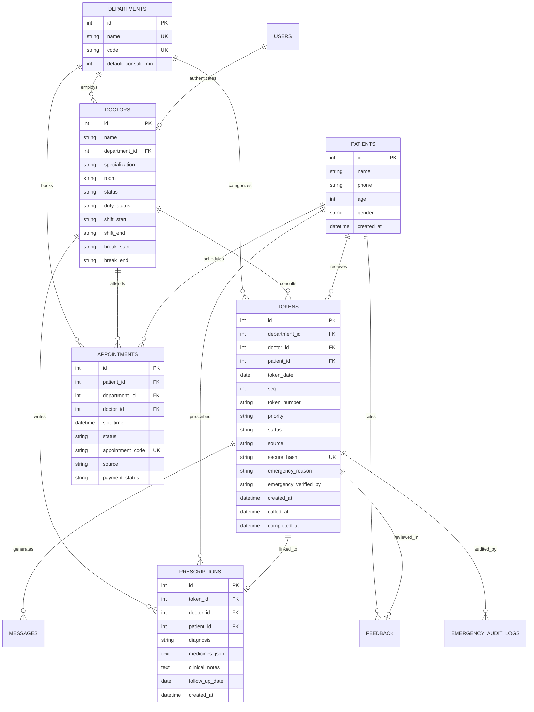

# 💾 HACKBYTE — DATABASE SCHEMA & DATA DICTIONARY
## Relational Tables, Data Models, Constraints & Storage Engines

---

## 1. Storage Engines Overview

The HealPath / QueueCare platform supports **three complementary storage mechanisms**:
1. **SQLite Database (`backend/queuecare.db`):** 12 normalized relational tables managed via SQLAlchemy 2.0 ORM with safe startup migrations (`backend/db.py`).
2. **Atomic In-Memory / File Store (`database/medicare_store.json`):** Synchronous file-backed JSON engine with mutex-locked atomic writes, ensuring zero-config local operation.
3. **Production Relational DDL (`database/schema.sql`):** Strict MySQL 8.0 / PostgreSQL compatible schema with foreign keys, cascading deletes, and unique compound constraints.

---

## 2. Relational Entity Relationship (ER) Diagram

---

## 3. Detailed Data Dictionary

### Table 1: `departments`
Stores clinical specialties and diagnostic divisions.
- `id` (INTEGER, PK): Unique department identifier.
- `name` (VARCHAR 100, UNIQUE, NOT NULL): Clinical name (e.g., "Cardiology", "Orthopedics").
- `code` (VARCHAR 5, UNIQUE, NOT NULL): Prefix for tokens (e.g., `C`, `O`, `SANJ`).
- `default_consult_min` (INTEGER, DEFAULT 8): Baseline consultation time used for wait-time estimations.

### Table 2: `doctors`
Stores doctor profiles, clinic suites, and availability.
- `id` (INTEGER, PK): Doctor ID.
- `name` (VARCHAR 100, NOT NULL): Full name with clinical title.
- `department_id` (INTEGER, FK $\rightarrow$ departments.id): Associated specialty.
- `specialization` (VARCHAR 100): Clinical qualification (e.g., "Cardiac Surgeon").
- `room` (VARCHAR 50): Clinic room assignment (e.g., "Room 201").
- `status` (VARCHAR 20, DEFAULT 'available'): Runtime state (`available` | `busy` | `off`).
- `duty_status` (VARCHAR 20, DEFAULT 'available'): Shift state (`available` | `busy` | `on_break` | `off_duty`).
- `shift_start` (VARCHAR 10, DEFAULT '09:00'): Shift commencement time.
- `shift_end` (VARCHAR 10, DEFAULT '17:00'): Shift completion time.
- `break_start` (VARCHAR 10, DEFAULT '13:00'): OPD break start.
- `break_end` (VARCHAR 10, DEFAULT '14:00'): OPD break resumption.

### Table 3: `tokens`
Core transaction table tracking real-time outpatient queuing.
- `id` (INTEGER, PK): Unique token record ID.
- `department_id` (INTEGER, FK $\rightarrow$ departments.id): Department code link.
- `doctor_id` (INTEGER, FK $\rightarrow$ doctors.id, NULLABLE): Assigned physician upon call.
- `patient_id` (INTEGER, FK $\rightarrow$ patients.id): Registered patient link.
- `token_date` (DATE, NOT NULL): OPD calendar date (resets daily sequence).
- `seq` (INTEGER, NOT NULL): Daily sequence counter (1, 2, 3...).
- `token_number` (VARCHAR 20, NOT NULL): Human-readable token (e.g., `C-012`, `SANJ-101`).
- `priority` (VARCHAR 20, DEFAULT 'normal'): Sorting tier (`emergency` | `senior` | `normal`).
- `status` (VARCHAR 20, DEFAULT 'waiting'): Lifecycle state (`waiting` | `in_progress` | `completed` | `skipped`).
- `source` (VARCHAR 20, DEFAULT 'online'): Channel origin (`online` | `walk_in` | `appointment`).
- `secure_hash` (VARCHAR 64, UNIQUE, NULLABLE): Cryptographic hash for QR arrival verification.
- `emergency_reason` (VARCHAR 300, NULLABLE): Triage reason for urgent escalation.
- `emergency_verified_by` (VARCHAR 100, NULLABLE): Staff username who authorized emergency tier.
- `created_at` (DATETIME): Queue entry timestamp.
- `called_at` (DATETIME, NULLABLE): Timestamp when doctor clicked "Call Next".
- `completed_at` (DATETIME, NULLABLE): Timestamp when consultation concluded.

### Table 4: `prescriptions`
Stores signed digital medical prescriptions.
- `id` (INTEGER, PK): Unique prescription ID.
- `token_id` (INTEGER, FK $\rightarrow$ tokens.id): Associated consultation turn.
- `appointment_id` (INTEGER, FK $\rightarrow$ appointments.id, NULLABLE): Linked slot reservation.
- `doctor_id` (INTEGER, FK $\rightarrow$ doctors.id): Authoring doctor.
- `patient_id` (INTEGER, FK $\rightarrow$ patients.id): Recipient patient.
- `diagnosis` (VARCHAR 255, NOT NULL): Clinical diagnosis.
- `medicines` (TEXT, NOT NULL): JSON-encoded array of prescribed drugs with `name`, `dosage`, `frequency`, `duration`, and `instructions`.
- `clinical_notes` (TEXT, NULLABLE): Lifestyle recommendations, diet, warning signs.
- `tests_recommended` (VARCHAR 255, NULLABLE): Lab tests or radiology orders.
- `follow_up_date` (DATE, NULLABLE): Recommended follow-up date.
- `created_at` (DATETIME): Prescription timestamp.

### Table 5: `patient_feedbacks`
Captures post-consultation patient satisfaction scores.
- `id` (INTEGER, PK): Feedback entry ID.
- `token_id` (INTEGER, FK $\rightarrow$ tokens.id, UNIQUE): Ensures one review per consultation turn.
- `patient_id` (INTEGER, FK $\rightarrow$ patients.id): Reviewer link.
- `department_id` (INTEGER, FK $\rightarrow$ departments.id): Evaluated department.
- `doctor_id` (INTEGER, FK $\rightarrow$ doctors.id, NULLABLE): Evaluated doctor.
- `rating` (INTEGER, 1 to 5): Overall consultation experience score.
- `wait_time_rating` (INTEGER, 1 to 5): Satisfaction with queue waiting duration.
- `staff_rating` (INTEGER, 1 to 5): Staff politeness and assistance rating.
- `comments` (TEXT, NULLABLE): Free-form patient suggestions.
- `is_anonymous` (BOOLEAN, DEFAULT FALSE): Anonymity flag.
- `created_at` (DATETIME): Review submission timestamp.
