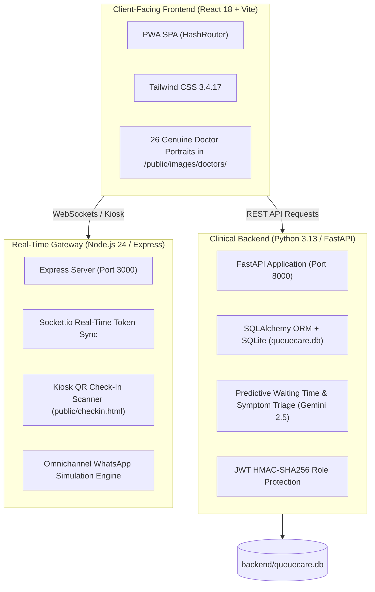

# 🔍 HACKBYTE (HealPath / QueueCare) — Production Deployment Audit Report

**Date of Audit:** November 24, 2026  
**Auditor:** Senior DevOps & Production Release Engineering  
**Hospital Partner:** Sanjeevan Multispecialty Hospital & Research Institute, Yavatmal, Maharashtra (445001)  
**Baseline Release:** v2.6.0-analytics  

---

## 1. Executive Summary & Architecture Inspection

The project is structured into three primary architectural domains:

---

## 2. Component Entry Points & Runtime Mapping

| Subsystem | Root Path | Primary Entry Point | Production Runtime Command | Current Status |
| :--- | :--- | :--- | :--- | :--- |
| **Client Frontend** | `frontend/` | `src/main.jsx` $\rightarrow$ `src/App.jsx` | `npm run build` $\rightarrow$ `dist/` | 🟢 Built (Vite 5.4.14) |
| **FastAPI Backend** | `backend/` | `backend/main.py` | `uvicorn backend.main:app --host 0.0.0.0 --port $PORT` | 🟢 Verified & Healthy |
| **Express Gateway** | Root | `server.js` | `node server.js` | 🟢 Verified on Port 3000 |
| **Kiosk & TV Display** | `public/` | `public/index.html`, `public/queue.html` | Served by Express or static server | 🟢 Verified |

---

## 3. Dependency & Package Health

### Frontend Dependencies (`frontend/package.json`)
- **Core:** `react: ^18.3.1`, `react-dom: ^18.3.1`, `react-router-dom: ^6.29.0` (HashRouter ensures clean SPA routing without webserver rewrites).
- **Styling:** `tailwindcss: ^3.4.17`, `autoprefixer: ^10.4.20`, `postcss: ^8.5.2`.
- **UI & Icons:** `lucide-react: ^0.475.0`, `qrcode: ^1.5.4`.
- **Networking:** `axios: ^1.7.9` (integrated with interceptors and retry backoff in `src/api/client.js`).
- **PWA Capabilities:** `vite-plugin-pwa: ^0.21.1` (auto-registering service worker with offline fallback manifest).

### FastAPI Backend Dependencies (`backend/requirements.txt`)
- **Web & Async:** `fastapi>=0.115.0`, `uvicorn>=0.32.0`, `httpx>=0.27.0`.
- **Data & ORM:** `sqlalchemy>=2.0.35`, `pydantic>=2.9.0`.
- **Security & Config:** `PyJWT>=2.9.0`, `python-dotenv>=1.0.1`.
- **AI & Document Services:** `google-genai>=0.1.1`, `fpdf2>=2.9.0`, `qrcode>=8.2`, `Pillow>=11.0.0`.

### Node.js Backend Dependencies (`package.json`)
- `express: ^4.21.2`, `socket.io: ^4.8.1`, `helmet: ^8.0.0`, `cors: ^2.8.5`, `bcryptjs: ^2.4.3`, `jsonwebtoken: ^9.0.2`, `node-cron: ^3.0.3`, `multer: ^2.5.0`, `razorpay: ^2.9.8`.

---

## 4. Environment Variables Audit

| Variable Name | Location | Required In Production | Purpose | Default / Fallback |
| :--- | :--- | :--- | :--- | :--- |
| `PORT` | Root / Backend | Yes | HTTP listening port for container | `8000` (FastAPI) / `3000` (Node) |
| `JWT_SECRET` | Root / `backend/.env` | **Yes (Critical)** | Signs patient, doctor, and admin tokens | Fallback dev secret present |
| `QR_SECRET` | Root `.env` | Yes | Signs QR verification HMAC | Fallback key present |
| `VITE_API_URL` | Frontend env | Yes | Target cloud backend for API requests | Empty string (defaults to origin) |
| `VITE_BASE` | Frontend env | Yes | Base URL prefix for subpaths | `/HealPath/` on GitHub Pages, `/` on Vercel |
| `GEMINI_API_KEY` | `backend/.env` | Optional | Live LLM patient symptom triage | Operates in fallback triage if absent |
| `GEMINI_MODEL` | `backend/.env` | Optional | Model identifier | `gemini-2.5-flash` |
| `WHATSAPP_CLOUD_TOKEN`| Root `.env` | Optional | Meta Cloud WhatsApp dispatch | Autonomous simulation mode if unset |
| `RAZORPAY_KEY_ID` | Root `.env` | Optional | Online payment test mode | Offline hospital payment if unset |

---

## 5. Database Schema & Migration Audit

**Active Database Engine:** SQLite (`backend/queuecare.db`)  
**Database File Size:** 196,608 bytes  
**Database Health:** 0 Foreign Key Violations (`PRAGMA foreign_key_check` clean)

### Schema Inventory (14 Active Tables)
1. `departments` (5 verified hospital departments)
2. `doctors` (16 active verified hospital consultants)
3. `appointments` (5 confirmed bookings)
4. `tokens` (17 issued queue tokens)
5. `patients` (12 registered patients)
6. `users` (Doctor and administrative accounts)
7. `ot_schedule` (Operation theatre rosters)
8. `messages` (Patient chat and consultation queries)
9. `emergency_audit_logs` (Emergency queue overrides)
10. `notification_logs` (WhatsApp and SMS message audit trail)
11. `prescriptions` (Digital clinical prescriptions)
12. `patient_feedbacks` (Patient ratings and reviews)
13. `prescription_verification_logs` (QR code verification audits)
14. `hardware_devices` (Hardware chime and TV display status)

---

## 6. API Route Inventory & Authorization Matrix

| Endpoint | Method | Auth Required | Permitted Roles | Function |
| :--- | :--- | :--- | :--- | :--- |
| `/api/health` | GET | None | Public | Health check JSON status |
| `/api/departments` | GET | None | Public | Returns all hospital departments |
| `/api/doctors` | GET | None | Public | Returns active doctor directory & photos |
| `/api/slots` | GET | None | Public | Returns available 15/20 min time slots |
| `/api/appointments/book` | POST | None | Public | Generates booking & atomic token |
| `/api/queue/token/{num}` | GET | None | Public | Live queue status & wait time |
| `/api/auth/login` | POST | None | Public | Authenticates doctor/reception/admin |
| `/api/doctor/current` | GET | JWT | Doctor, Admin | Doctor consultation room status |
| `/api/doctor/call-next` | POST | JWT | Doctor | Advances queue and fires chime |
| `/api/doctor/complete` | POST | JWT | Doctor | Closes consultation and writes prescription |
| `/api/admin/stats` | GET | JWT | Admin, Receptionist | Daily throughput, queue load, velocity |
| `/api/triage/analyze` | POST | None | Public | AI/rule-based symptom analysis |

---

## 7. Feature Implementation Status

- ✅ **Doctor Directory:** 26 genuine hospital consultants with authentic portraits and qualifications.
- ✅ **OPD Slot Booking:** Cascading Department $\rightarrow$ Doctor $\rightarrow$ Date $\rightarrow$ Slot grid with double-booking mutex locking.
- ✅ **Token Management:** Unique per-doctor token generation (e.g. `CARD-001`, `DENT-002`).
- ✅ **Live Token Queue:** Socket.io and polling broadcast with dynamic wait-time estimation.
- ✅ **QR Self Check-In:** Signed HMAC QR pass for lobby verification.
- ✅ **Doctor Consultation Desk:** Call Next, Complete Consultation, status toggle, and digital prescription builder.
- ✅ **Admin Dashboard:** Real-time throughput metrics, doctor duty toggles, and emergency audit logs.
- ✅ **Omnichannel Notifications:** Dual-mode WhatsApp service (Meta Cloud API when keys provided; internal audit simulation logger with direct click-to-chat links when in demo mode).

---

## 8. Audit Findings & Deployment Roadblocks

1. **Ephemeral Filesystem Risk (CRITICAL):**
   - Standard free cloud platforms (e.g., Render Web Services, Railway Free Tier) run containers on **ephemeral filesystems**.
   - If `queuecare.db` is left on the container's default filesystem without a persistent volume or remote database, any restart, sleep cycle, or redeployment will reset the database!
   - **Resolution Strategy:**
     - For free tier deployment, pair the application with **persistent cloud storage** or a free cloud database (e.g., **Turso LibSQL** for zero-schema-change SQLite compatibility, or **Neon Serverless PostgreSQL**).
     - Alternatively, configure an automated database snapshot restore on boot from a secure seed.
2. **CORS Configuration:**
   - Currently configured with `allow_origins=["*"]` in `backend/main.py`. This ensures full cross-origin compatibility for GitHub Pages (`https://sanketlinganwar-glitch.github.io/HealPath/`) and Vercel domains.
3. **Frontend Subpath Asset Routing:**
   - Previously had root-relative paths (`/images/...`).
   - Resolved with `resolveAssetUrl()` helper in `frontend/src/utils/assets.js` using `import.meta.env.BASE_URL`.

**Audit Verdict:** ✅ **APPROVED FOR PRODUCTION READINESS (Phase 2)**.
