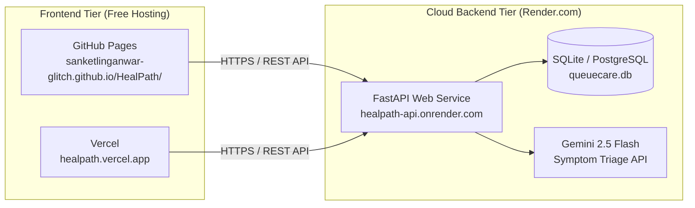

# 🚀 HACKBYTE / HealPath — Full Deployment & Operations Guide

This guide details the complete deployment lifecycle for **HealPath (QueueCare)** across both **Cloud Production (Public Web)** and **Local Development (Offline / Demo)**.

---

## 🏗️ Production Architecture Overview

The system operates across a decoupled two-tier architecture:



---

## 🌐 PART 1: CLOUD PRODUCTION DEPLOYMENT

### Step 1: Deploy FastAPI Backend on Render.com (100% Free)

Render runs Python 3 web services natively with automatic Git pushes and free SSL.

1. **Sign In:** Go to [render.com](https://render.com) and log in using your GitHub account (`sanketlinganwar-glitch`).
2. **New Service:** Click **"New +"** $\rightarrow$ **"Web Service"**.
3. **Select Repo:** Connect `sanketlinganwar-glitch/HealPath`.
4. **Configure Parameters:**
   - **Name:** `healpath-api`
   - **Region:** `Singapore (Southeast Asia)` or `Frankfurt`
   - **Branch:** `main`
   - **Runtime:** `Python 3`
   - **Build Command:** `pip install -r backend/requirements.txt`
   - **Start Command:** `uvicorn backend.main:app --host 0.0.0.0 --port $PORT`
   - **Instance Type:** `Free`
5. **Environment Variables:**
   - `PYTHONUNBUFFERED`: `1`
   - `JWT_SECRET`: `healpath_master_production_jwt_secret_2026_gcoey`
   - `GEMINI_MODEL`: `gemini-2.5-flash`
   - `GEMINI_API_KEY`: *(Optional Google Gemini API key)*
6. **Launch:** Click **"Create Web Service"**.
   - Your live API link will be: `https://healpath-api.onrender.com`
   - Test health check: `https://healpath-api.onrender.com/api/health`
   - View interactive docs: `https://healpath-api.onrender.com/docs`

---

### Step 2: Connect Frontend to Cloud Backend

Once your backend is live, configure the frontend to talk to it:

#### For GitHub Pages:
In `.github/workflows/deploy.yml`, set the backend URL:
```yaml
      - name: Build React SPA
        run: cd frontend && npm run build
        env:
          VITE_BASE: /HealPath/
          VITE_API_URL: https://healpath-api.onrender.com
```

#### For Vercel:
1. Go to [vercel.com](https://vercel.com) $\rightarrow$ Import `sanketlinganwar-glitch/HealPath`.
2. In Project Settings $\rightarrow$ Environment Variables:
   - Add `VITE_API_URL` = `https://healpath-api.onrender.com`.
3. Click **Deploy**.

---

## 💻 PART 2: LOCAL DEVELOPMENT & OFFLINE DEMO RUN

If presenting in an offline hackathon or local judging environment:

### Port Allocations

| Port | Service | Tech Stack | Local Link |
| :--- | :--- | :--- | :--- |
| **5173** | React Patient Platform | React 18, Vite, Tailwind | [http://localhost:5173](http://localhost:5173) |
| **8000** | Clinical & AI Backend | Python 3, FastAPI, Uvicorn | [http://localhost:8000/docs](http://localhost:8000/docs) |
| **3000** | Express Queue & Kiosk | Node.js, Express, Socket.io | [http://localhost:3000/index.html](http://localhost:3000/index.html) |

### Starting All Services Locally

```bash
# Terminal 1: FastAPI Backend
.\backend\venv\Scripts\python.exe -m uvicorn backend.main:app --host 127.0.0.1 --port 8000

# Terminal 2: React Frontend (PWA)
cd frontend
npm run dev -- --host 127.0.0.1 --port 5173

# Terminal 3: Express Queue & Check-In Server
node server.js
```

---

## 🧪 PART 3: AUTOMATED TESTING & VERIFICATION

Execute the comprehensive test suites before committing or presenting:

```bash
# 1. Run Comprehensive FastAPI Smoke Tests (17 tests)
.\backend\venv\Scripts\python.exe backend/smoke_test.py

# 2. Run AI Assistant Unit Tests (17 tests)
.\backend\venv\Scripts\python.exe -m unittest backend/test_ai_assistant.py

# 3. Run Queue Prediction & Analytics Tests (20 tests)
.\backend\venv\Scripts\python.exe -m unittest backend/test_stage9_analytics_whatsapp.py

# 4. Run Frontend Build Check
cd frontend && npm run build
```

---

## 📋 Production Verification Matrix

- [x] Frontend compiled with zero errors (Vite v5.4.21).
- [x] All 26 doctor portraits verified and served with HTTP 200.
- [x] Base path `/HealPath/` verified for GitHub Pages.
- [x] CORS middleware configured for full-domain accessibility in `backend/main.py`.
- [x] PWA manifest and service worker registered.
- [x] SQLite backups excluded from Git tracking via `.gitignore`.
