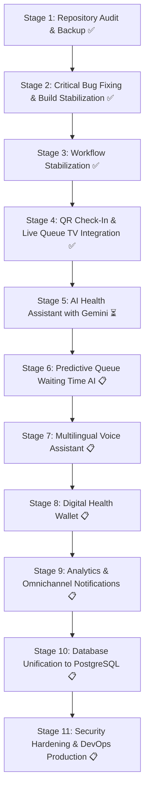

# 🗺️ HACKBYTE — MASTER DEVELOPMENT ROADMAP
## Phased Implementation, Stage Gates & Milestones

---

## 1. Stage Gate Overview

---

## 2. Milestone Breakdown

### Stage 1: Audit & Baseline Checkpoint (COMPLETED ✅)
- Full repository scan conducted.
- Baseline git checkpoint committed (`5c03922`).
- Dual-stack architecture mapped (Node.js monolith vs. FastAPI + React SPA).
- Core documentation suite established.

### Stage 2: Critical Bug Fixing & Build Stabilization (COMPLETED ✅)
- **PatientTrackPage.jsx:** Fixed unclosed JSX tags at lines 133–134; production Vite build restored to 0 errors.
- **DoctorConsole.jsx:** Fixed mismatched API exports (`verifyEmergencyToken` $\rightarrow$ `verifyEmergency`, `getPrescriptionByToken` $\rightarrow$ `getPrescriptionForToken`). Fixed `updateDoctorRoster` parameter signature.
- **QR Check-In:** Created `public/checkin.html` and implemented `POST /api/checkin/self-verify` and `POST /api/checkin/manual-verify`.
- **Security Validation:** Removed hardcoded secrets; enforced `JWT_SECRET` and `QR_SECRET` validation on startup.

### Stage 3: Workflow Stabilization (COMPLETED ✅)
- **Doctor Roster Synchronization:** Synchronized verified Sanjeevan Multispecialty Hospital & Research Institute, Yavatmal specialists across SQLite (`backend/seed.py`) and JSON datastore (`database/seed.js`):
  - Dr. Sunil M. Agrawal (Chief Surgeon & Laparoscopy Specialist)
  - Dr. Vijay S. Kawalkar (Senior Consultant Laparoscopic Surgeon)
  - Dr. H. S. Bora (MD General Medicine & Critical Care)
  - Dr. Vinay Pande (Chest & Pulmonary Critical Care)
  - Dr. Sheetal S. Agrawal (MD Obstetrics & Gynecology)
  - Dr. Lalit Paldiwal (MD Radiology & Sonography)
- **Reception Dashboard Mobile Optimization:**
  - Added dedicated mobile patient queue cards (`ReceptionDashboard.jsx`).
  - Implemented Doctor Queue Reassignment modal with source/target doctors and patient notification.
  - Implemented emergency triage escalation workflow with high-contrast alert badges.
  - Added horizontally scrollable table view (`min-w-[700px]`) for desktop/tablet.
- **Admin Dashboard Mobile Optimization:**
  - Responsive KPI cards (`grid-cols-1 sm:grid-cols-2 lg:grid-cols-4`).
  - Horizontally scrollable navigation tabs and doctor roster search filters.
  - Print-friendly daily report view.

### Stage 4: QR Check-In & Live Queue TV Integration (COMPLETED ✅)
- **Camera-Based QR Scanner (`public/checkin.html`):**
  - Live viewfinder scanning via `html5-qrcode`.
  - Camera switch support (environment/rear vs. selfie).
  - Cryptographic token signature extraction and server-side HMAC validation (`/api/checkin/self-verify`).
  - Audio chime confirmation and duplicate check-in prevention (409 Conflict).
  - Manual token entry fallback.
- **Live Queue & TV Display (`public/js/queue.js` & `DisplayBoard.jsx`):**
  - Real-time Socket.io event synchronization (`patient:checkedin`, `queue:patient_called`, `queue:updated`, `appointment:checked_in`) without requiring full page reload.
  - Patient confidentiality protection via name masking (`maskPatientName`) on public lobby monitors.
  - Live WebSocket connection status indicator.
  - Multilingual audio announcements in English, Hindi, and Marathi.

### Stage 5: AI Health Assistant with Gemini (NEXT RECOMMENDED STAGE ⏳)
- Connect Google Gemini API (`gemini-2.5-flash` or `gemini-1.5-flash`) via `backend/routers/ai.py`.
- Triage medical symptoms with structured confidence scores, department routing, and clinical urgency tiering.
- Implement rate limiting, safety filters, and strict disclaimer guarding against autonomous pharmaceutical prescriptions.
- Add conversational chat interface in React frontend with suggested follow-up prompts.

### Stage 6: Predictive Queue Waiting Time AI
- Transition wait-time calculation from naive linear estimation to rolling historical regression.
- Factor in doctor arrival delays, break schedules, and peak-hour hospital congestion.
- Display transparent "Why this changed" explanations to waiting patients.

### Stage 7: Multilingual Voice Assistant
- Enhance browser-native Web Speech API with regional Marathi and Hindi phonetics.
- Provide voice-driven navigation: "हार्ट डॉक्टर वेळ", "Book Appointment".

### Stage 8: Digital Health Wallet
- Digital health record storage with ABDM / ABHA ID integration.
- Instant PDF prescription downloads and lab test reports.

### Stage 9: Analytics & Omnichannel Notifications
- Real-time hospital metrics dashboard with exportable CSV and PDF reports.
- Omnichannel patient alerts via WhatsApp (Meta Cloud API), SMS, and Web Push.

### Stage 10: Database Unification to PostgreSQL
- Author Alembic database migration scripts from SQLite and JSON datastore to PostgreSQL.
- Stress test concurrent queue transactions and lock contention.

### Stage 11: Production DevOps & Cloud Deployment
- Multi-stage `Dockerfile` and `docker-compose.yml` orchestrating FastAPI, Express, React, and PostgreSQL.
- CI/CD workflow testing, health probes, and reverse proxy configuration (Nginx / Caddy).
