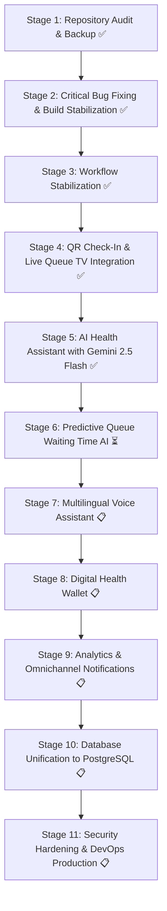

# 🗺️ HACKBYTE — MASTER DEVELOPMENT ROADMAP
## Phased Implementation, Stage Gates & Milestones

---

## 1. Stage Gate Overview

---

## 2. Milestone Breakdown

### Stage 1: Audit & Baseline Checkpoint (COMPLETED ✅)
- Full repository scan conducted.
- Baseline git checkpoint committed (`5c03922`).
- Dual-stack architecture mapped (Node.js monolith vs. FastAPI + React SPA).
- Core documentation suite established.

### Stage 2: Critical Bug Fixing & Build Stabilization (COMPLETED ✅)
- **PatientTrackPage.jsx:** Fixed unclosed JSX tags at lines 133–134; production Vite build restored to 0 errors.
- **DoctorConsole.jsx:** Fixed mismatched API exports (`verifyEmergencyToken` $\rightarrow$ `verifyEmergency`, `getPrescriptionByToken` $\rightarrow$ `getPrescriptionForToken`). Fixed `updateDoctorRoster` parameter signature.
- **QR Check-In:** Created `public/checkin.html` and implemented `POST /api/checkin/self-verify` and `POST /api/checkin/manual-verify`.
- **Security Validation:** Removed hardcoded secrets; enforced `JWT_SECRET` and `QR_SECRET` validation on startup.

### Stage 3: Workflow Stabilization (COMPLETED ✅)
- **Doctor Roster Synchronization:** Synchronized verified Sanjeevan Multispecialty Hospital & Research Institute, Yavatmal specialists across SQLite (`backend/seed.py`) and JSON datastore (`database/seed.js`):
  - Dr. Sunil M. Agrawal (Chief Surgeon & Laparoscopy Specialist)
  - Dr. Vijay S. Kawalkar (Senior Consultant Laparoscopic Surgeon)
  - Dr. H. S. Bora (MD General Medicine & Critical Care)
  - Dr. Vinay Pande (Chest & Pulmonary Critical Care)
  - Dr. Sheetal S. Agrawal (MD Obstetrics & Gynecology)
  - Dr. Lalit Paldiwal (MD Radiology & Sonography)
- **Reception Dashboard Mobile Optimization:**
  - Added dedicated mobile patient queue cards (`ReceptionDashboard.jsx`).
  - Implemented Doctor Queue Reassignment modal with source/target doctors and patient notification.
  - Implemented emergency triage escalation workflow with high-contrast alert badges.
  - Added horizontally scrollable table view (`min-w-[700px]`) for desktop/tablet.
- **Admin Dashboard Mobile Optimization:**
  - Responsive KPI cards (`grid-cols-1 sm:grid-cols-2 lg:grid-cols-4`).
  - Horizontally scrollable navigation tabs and doctor roster search filters.
  - Print-friendly daily report view.

### Stage 4: QR Check-In & Live Queue TV Integration (COMPLETED ✅)
- **Camera-Based QR Scanner (`public/checkin.html`):**
  - Live viewfinder scanning via `html5-qrcode`.
  - Camera switch support (environment/rear vs. selfie).
  - Cryptographic token signature extraction and server-side HMAC validation (`/api/checkin/self-verify`).
  - Prevented duplicate check-ins (409 Conflict) and handled expired slots (410 Gone).
  - Maintained manual token entry fallback.
- **Live Queue & TV Display Integration:**
  - Implemented patient privacy masking (`maskPatientName`) protecting confidential healthcare information.
  - Verified Socket.io real-time events (`patient:checkedin`, `queue:patient_called`, `queue:updated`, `appointment:checked_in`).
  - Multilingual voice announcements (EN, HI, MR) without page refresh.

### Stage 5: AI Health Assistant with Gemini 2.5 Flash (COMPLETED ✅)
- **Google Gemini 2.5 Flash API Integration:**
  - Integrated official Google Gen AI SDK (`google-genai` v2.33.0) with 15-second request timeouts.
  - Configured `GEMINI_API_KEY` and `GEMINI_MODEL` (`gemini-2.5-flash`) exclusively in backend environment.
  - Zero API key exposure to browser or frontend bundles.
- **AI Symptom Triage Engine (`POST /api/ai/triage`):**
  - Structured symptom intake (complaint, duration, severity, age group, associated symptoms).
  - Department recommendation and urgency classification (`ROUTINE`, `MODERATE`, `URGENT`, `EMERGENCY`).
  - Strict Healthcare Safety Guardrails: Assistant operates as navigation/triage guide only, barred from medical diagnoses or prescribing drugs.
- **Emergency Red-Flag Intercept & Escalation:**
  - Hardened pattern-matching rules for cardiac, respiratory, stroke, trauma, and poisoning conditions.
  - Multi-lingual keywords across English, Hindi, and Marathi.
  - Emergency conditions override model outputs to enforce `EMERGENCY` with Sanjeevan Hospital 24/7 Hotline (+91 95526 25262) callout.
- **Multi-Turn Conversational Session Engine:**
  - `ConversationStore` with UUID session isolation to guarantee complete privacy between patients.
  - Context window retaining the last 10 messages for conversational flow.
  - Session rate-limiting enforced at 20 requests/minute.
  - `POST /api/ai/conversation/reset` endpoint to wipe chat history on demand.
  - Real-time token queue wait context injection.
- **Deterministic Offline Fallback Protocol:**
  - Automated fallback when Gemini API key is absent, network fails, or request times out.
  - Evaluates patient symptoms against standard Sanjeevan Hospital OPD protocols with clear offline labeling (`is_offline_fallback: true`).
- **React AI Health Assistant Interface (`AIHealthAssistant.jsx`):**
  - Floating launcher button with glowing pulse animation.
  - Modern chat bubbles with timestamps, quick prompts, and urgency badges.
  - Trilingual support (English, Hindi, Marathi) with instant switching.
  - Integrated Web Speech API for voice queries and audio playback.
  - Globally mounted in `AppLayout` and aliased through `ChatWidget.jsx`.

### Stage 6: Predictive Queue Waiting Time AI (NEXT TARGET ⏳)
- Historical consultation duration regression model based on department and time of day.
- Dynamic turn recalculation when emergency patients are prioritized into the queue.
- Real-time doctor consultation pace tracking and delay notifications.

### Stage 7: Multilingual Voice Assistant (FUTURE 📋)
- Low-latency voice interaction in English, Hindi, and Marathi using Gemini Live API / Web Speech API.
- Dialect handling for Vidarbha regional Marathi.

### Stage 8: Digital Health Wallet (FUTURE 📋)
- Offline-first token pass with PWA caching.
- Digital prescription download with QR-verified digital signature.
- Lab test report integration with secure viewing.

### Stage 9: Analytics & Omnichannel Notifications (FUTURE 📋)
- WhatsApp Cloud API webhook for automated turn alerts (3 patients ahead, 1 patient ahead).
- SMS fallback via Fast2SMS / Twilio.
- Department bottleneck heatmaps and wait time analytics for hospital management.

### Stage 10: Database Unification to PostgreSQL (FUTURE 📋)
- Migrate atomic JSON datastore and SQLite to a single PostgreSQL production instance.
- Dual-write transition followed by decommissioning of the legacy Express datastore.

### Stage 11: Security Hardening & DevOps Production (FUTURE 📋)
- Complete OWASP Top 10 compliance audit.
- Docker multi-container composition (`docker-compose.prod.yml`).
- Caddy / Nginx reverse proxy with automated Let's Encrypt SSL/TLS.
