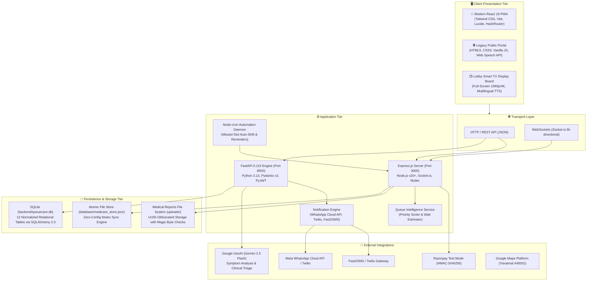

# 🗺️ HACKBYTE — SYSTEM ARCHITECTURE
## End-to-End Technical Architecture & Component Interaction Flow

---

## 1. High-Level Architecture Overview

HealPath / QueueCare employs a **modern, multi-tier decoupled architecture** designed for high throughput, sub-50ms queue reactivity, and operational reliability in clinical environments.

---

## 2. Dual-Stack Component Breakdown

### Stack A: Express.js Monolith (Port 3000)
- **Role:** Production-ready real-time waiting room server, Socket.io event broadcaster, and static web server.
- **Entry Point:** `server.js`
- **Key Modules:**
  - `routes/checkin.js`: Cryptographic HMAC-SHA256 arrival verification (`/api/checkin/self-verify`, `/api/checkin/manual-verify`, `/api/checkin/scan`).
  - `routes/payments.js`: Razorpay order creation with 10-minute slot hold and webhook HMAC audit trail.
  - `routes/reports.js`: Medical report uploads via Multer with memory buffer, 5MB ceiling, and `file-type` magic byte verification.
  - `services/cron.js`: 60-second autonomous worker checking missed slots past the 10-minute grace period.
  - `services/whatsapp.js`: Omnichannel messaging with automatic fallback to live simulation.
  - `socket/socketHandler.js`: WebSocket rooms broadcasting `queue:patient_called`, `slot:booked`, and `patient:checkedin`.

### Stack B: FastAPI + React PWA (Ports 8000 & 5173)
- **Role:** RESTful, API-contract compliant healthcare operations platform.
- **Backend Entry Point:** `backend/main.py`
- **Frontend Entry Point:** `frontend/src/main.jsx`
- **Key Modules:**
  - `backend/routers/auth.py`: PyJWT Bearer token issuer (HS256, 12h expiry) and PBKDF2 HMAC SHA-256 password security.
  - `backend/routers/appointments.py`: Slot matrix generator factoring in doctor duty rosters, break windows, and bookings.
  - `backend/routers/prescriptions.py`: Digital prescription authoring with medication dosage, frequency, and follow-ups.
  - `backend/routers/feedback.py`: Patient satisfaction scoring and department review aggregations.
  - `backend/routers/staff.py`: Doctor console, call-next logic, emergency audit log inspection, and OT schedule.
  - `backend/routers/queue.py`: Stage 6 Predictive Queue Waiting Time AI endpoints (`/api/queue/prediction/{id}`, `/api/queue/doctor-predictions/{id}`, `/api/queue/department-predictions/{id}`).
  - `backend/services/queue_prediction.py`: Stage 6 multi-factor queue waiting time prediction engine featuring in-progress elapsed consultation deduction, doctor velocity modeling, emergency shift calculation, time-of-day multipliers, and 90% confidence interval ranges.
  - `backend/services/ai_service.py`: Stage 5 AI Symptom Triage Engine and conversational assistant powered by Google Gemini 2.5 Flash with UUID session isolation, sliding context window, 20 req/min rate limiting, and Sanjeevan Hospital deterministic offline fallback.
  - `frontend/src/components/AIHealthAssistant.jsx`: Trilingual (EN/HI/MR) floating AI assistant with quick symptom prompts, color-coded urgency badges, emergency hotline escalation (+91 95526 25262), and Web Speech voice recognition/synthesis.
  - `frontend/src/pages/DisplayBoard.jsx`: Full-screen lobby smart TV dashboard with browser-native Web Speech TTS in Hindi/Marathi.
  - `frontend/src/pages/PatientTrackPage.jsx`: Live token tracking card with WhatsApp sharing, QR pass, and staff updates.

---

## 3. Communication Protocols

1. **REST APIs (HTTP/1.1):** Standard JSON payloads adhering to `{ "detail": "human readable error" }` on HTTP 4xx/5xx status codes.
2. **5-Second Reactive Polling:** The React SPA utilizes `usePolling.js` with exponential backoff on connection loss to maintain synchronization without WebSocket dependency on low-end mobile browsers.
3. **Socket.io WebSockets:** Express emits low-latency binary-efficient messages to smart TV monitors and doctor desks (`slot:booked`, `queue:patient_called`).

---

## 4. Long-Term Consolidation Roadmap

To streamline maintenance and reduce duplication, the system is designed to converge toward **React 18 + FastAPI** with a unified database:
- **Phase A (Current):** Express and FastAPI operate concurrently; Express manages WebSockets and Razorpay; FastAPI serves clinical REST APIs.
- **Phase B (Intermediate):** Port Socket.io or FastAPI native WebSockets into `backend/main.py`.
- **Phase C (Final):** Migrate all data stores to a single PostgreSQL production instance using Alembic migrations.
