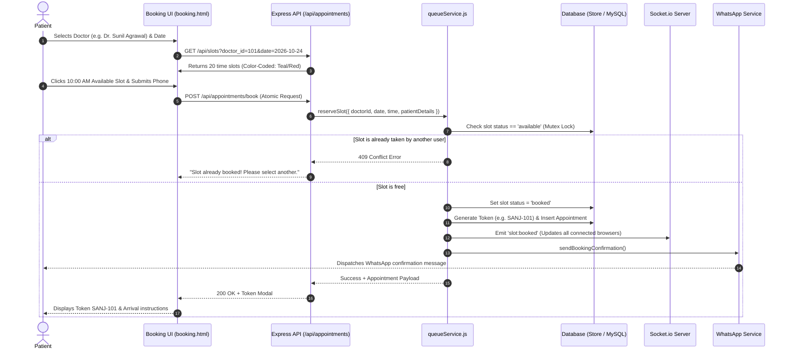
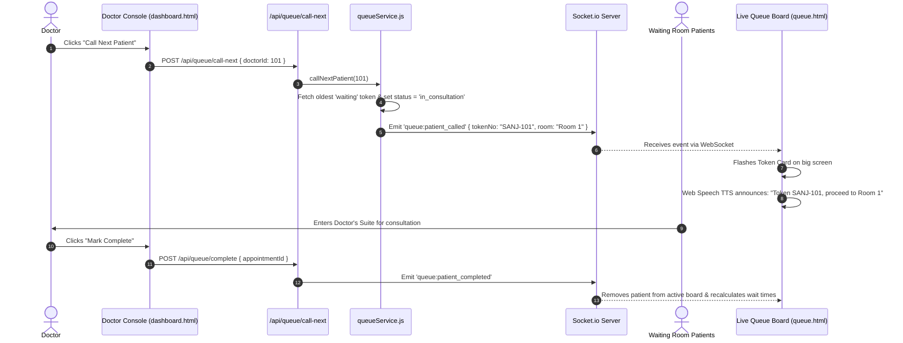
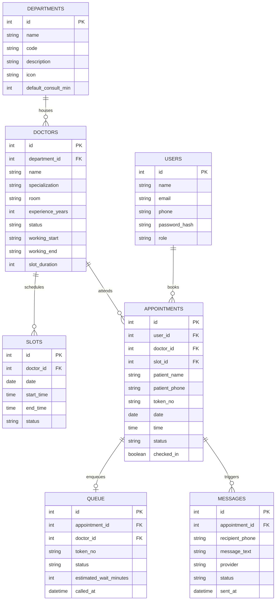

# 🗺️ HealPath — Technical Architecture & Complete Flowcharts

This document details the complete end-to-end architecture, technology stack, and process flowcharts for **HealPath** (Hospital Website, Smart Appointment & Live Queue System), integrated with **Sanjivani Hospital, Yavatmal (445001)**.

---

## 1. High-Level System Architecture Diagram

```mermaid
graph TB
    subgraph CLIENT_TIER["🖥️ Frontend Tier (Browser & Smart TV Display)"]
        UI_HOME["🏠 Public Hospital Website<br/>(index, services, doctors, about, contact)"]
        UI_BOOK["📅 Slot Booking Engine<br/>(booking.html + booking.js)"]
        UI_QUEUE["📺 Live Queue Board<br/>(queue.html + audio TTS)"]
        UI_DASH["📊 Role Dashboards<br/>(Patient / Doctor / Admin)"]
        UI_AI["🤖 Multilingual Voice Bot<br/>(Web Speech API - EN/HI/MR)"]
    end

    subgraph NETWORK["🌐 Transport & Protocol Layer"]
        HTTP["HTTP / REST API (Express)"]
        WS["WebSockets (Socket.io Bi-directional)"]
    end

    subgraph SERVER_TIER["⚙️ Backend Tier (Node.js & Express Server)"]
        SERVER["server.js (Express + Socket.io Server)"]
        ROUTERS["API Routers:<br/>/auth, /departments, /doctors,<br/>/slots, /appointments, /queue,<br/>/admin, /chat, /hospital/sanjivani"]
        QUEUE_SVC["services/queueService.js<br/>(Atomic Slot Reservation & Token Engine)"]
        WA_SVC["services/whatsapp.js<br/>(WhatsApp Cloud API / Twilio Adapter)"]
        CRON_ENGINE["services/cron.js (node-cron)<br/>(10-Min Grace Period & Auto-Shift Daemon)"]
    end

    subgraph DATA_TIER["💾 Storage & Database Tier"]
        DB_ATOMIC["Zero-Config Atomic Store<br/>(database/medicare_store.json)"]
        DB_MYSQL["MySQL Relational DB<br/>(8 Normalized Tables)"]
    end

    subgraph EXTERNAL["🔌 External Services & Third Parties"]
        META_WA["Meta WhatsApp Cloud API<br/>/ Twilio API"]
        MAPS["Google Maps Platform<br/>(Yavatmal 445001 Geolocation)"]
        HOSPITAL_API["Sanjivani Hospital Yavatmal<br/>(Facility ID: HFR-MH-YTL-445001-089)"]
    end

    CLIENT_TIER -->|REST Requests| HTTP --> ROUTERS --> QUEUE_SVC
    CLIENT_TIER <-->|Real-Time Sync (<50ms)| WS <--> SERVER
    QUEUE_SVC --> DB_ATOMIC
    QUEUE_SVC --> DB_MYSQL
    QUEUE_SVC --> WA_SVC --> META_WA
    CRON_ENGINE -->|Every 60s Check| QUEUE_SVC
    QUEUE_SVC -->|Socket Broadcast| WS
    ROUTERS --> HOSPITAL_API
    UI_HOME --> MAPS
```

---

## 2. End-to-End User Journeys (Process Flowcharts)

### A. Patient Appointment Booking Flow (Atomic Reservation)



---

### B. Doctor Call & Live Queue TV Screen Flow



---

### C. Missed-Slot Protection & 10-Minute Auto-Shift Flow

```mermaid
flowchart TD
    START([⏱️ Background node-cron job triggers every 60s]) --> FETCH[Scan today's booked appointments with status = 'waiting']
    FETCH --> CHECK_TIME{Current Time > Scheduled Slot + 10 mins?}
    
    CHECK_TIME -- No --> WAIT[Leave token in waiting state]
    CHECK_TIME -- Yes --> CHECK_IN{Patient checked in?}
    
    CHECK_IN -- Yes --> PROTECT[Patient has arrived. Protect token from shift.]
    CHECK_IN -- No --> SCAN_SLOT{Next available slot today exists for Doctor?}
    
    SCAN_SLOT -- Yes --> SHIFT[Auto-shift appointment to next open slot<br/>Update token and timestamps]
    SHIFT --> DB_UPDATE[Save updated slot in Database]
    DB_UPDATE --> WS_BROADCAST[Socket.io broadcasts 'queue:updated' to Live TV]
    WS_BROADCAST --> WA_ALERT[WhatsApp dispatches:<br/>'⚠️ You missed 10:00 AM slot. Auto-shifted to 11:30 AM.']
    
    SCAN_SLOT -- No --> MARK_MISSED[Mark appointment status = 'missed'<br/>(No later slots today)]
    MARK_MISSED --> WA_MISSED[WhatsApp notifies patient to reschedule for tomorrow]
```

---

## 3. Technology Stack Breakdown Table

| Tier / Domain | Technology Used | Version / Library | Purpose in HealPath |
| :--- | :--- | :--- | :--- |
| **Frontend Core** | **HTML5** | Modern Semantic HTML | Page structuring, accessibility, meta tags, responsive container layout |
| **Frontend Styling** | **Vanilla CSS3** | Custom Design System | High-performance design without Tailwind overhead (`--deep-blue`, `--teal`, `--mint`, glassmorphism, pulse loaders) |
| **Typography** | **Google Fonts** | *Plus Jakarta Sans* | Premium medical aesthetic and legibility |
| **Icons** | **Font Awesome** | v6.5.1 CDN | Clinical, role, status, and navigation iconography |
| **Client Scripting** | **Vanilla JavaScript** | ES6+ Modules | Dynamic slot matrix, auth state, modal dialogs, DOM rendering |
| **Live WebSockets** | **Socket.io Client** | v4.7.4 | Real-time live queue sync (<50ms latency), doctor calls, slot locking |
| **Speech Recognition** | **Web Speech API** | Native Browser API | Speech-to-Text (`webkitSpeechRecognition`) in English, Hindi, and Marathi |
| **Speech Synthesis** | **Web Speech API** | Native Browser API | Text-to-Speech (`speechSynthesis`) token room announcements |
| **Localization** | **Custom i18n Engine** | `public/js/i18n.js` | Full site translation across English (`en`), Hindi (`hi`), Marathi (`mr`) |
| **Backend Runtime** | **Node.js** | v18+ LTS | Event-driven non-blocking I/O server runtime |
| **Backend Framework**| **Express.js** | v4.18.2 | RESTful routing, static file hosting, middleware pipeline |
| **Realtime Server** | **Socket.io Server** | v4.7.4 | WebSocket room broadcasting, connection tracking, event bus |
| **Background Cron** | **node-cron** | v3.0.3 | Autonomous 60-second background job evaluating missed slots & grace periods |
| **Security & Headers**| **Helmet.js** | v7.1.0 | Protection against XSS, clickjacking, MIME-sniffing |
| **CORS Handling** | **cors** | v2.8.5 | Cross-Origin Resource Sharing control |
| **Rate Limiting** | **express-rate-limit** | v7.1.5 | DDoS & brute-force protection (500 req / 15 mins) |
| **Authentication** | **jsonwebtoken (JWT)** | v9.0.2 | Stateless bearer token authentication with role-based access control (RBAC) |
| **Password Hashing** | **bcryptjs** | v2.4.3 | Salt-hashed password encryption for all user credentials |
| **Primary Database** | **Atomic JSON Engine** | `database/db.js` | Zero-config atomic JSON persistence (`medicare_store.json`) for instant hackathon portability |
| **Production DB** | **MySQL** | `mysql2` v3.9.1 | Enterprise relational database with 8 normalized schemas |
| **Messaging API** | **WhatsApp Cloud API** | Meta Graph v18.0 | Enterprise transactional WhatsApp message dispatch |
| **Fallback Messaging**| **Twilio API** | Twilio REST API | Secondary SMS/WhatsApp gateway |
| **Hospital Partner** | **Sanjivani Hospital API**| Custom REST Routes | Grounded integration with Sanjeevan Hospital Yavatmal (445001) |

---

## 4. Database Schema Structure (8 Core Tables)



---

## 5. Security & Reliability Architecture

1. **Authentication & RBAC:**
   - 4 distinct roles: `patient`, `doctor`, `receptionist`, `admin`.
   - Doctor endpoints (`PATCH /api/doctors/:id/status`, `POST /api/queue/call-next`) require active JWT token and role authorization.
2. **Atomic In-Memory Locks:**
   - Prevents race conditions during slot reservations.
3. **Graceful Failover:**
   - If MySQL is down, the system instantly switches to the zero-config atomic storage engine (`database/medicare_store.json`) without throwing errors.
   - If WhatsApp API keys are unconfigured, notifications seamlessly route through the simulated WebSocket toast stream.
4. **Port Failover:**
   - If port `3000` is occupied, `server.js` automatically binds to `3001` or next free port gracefully.
